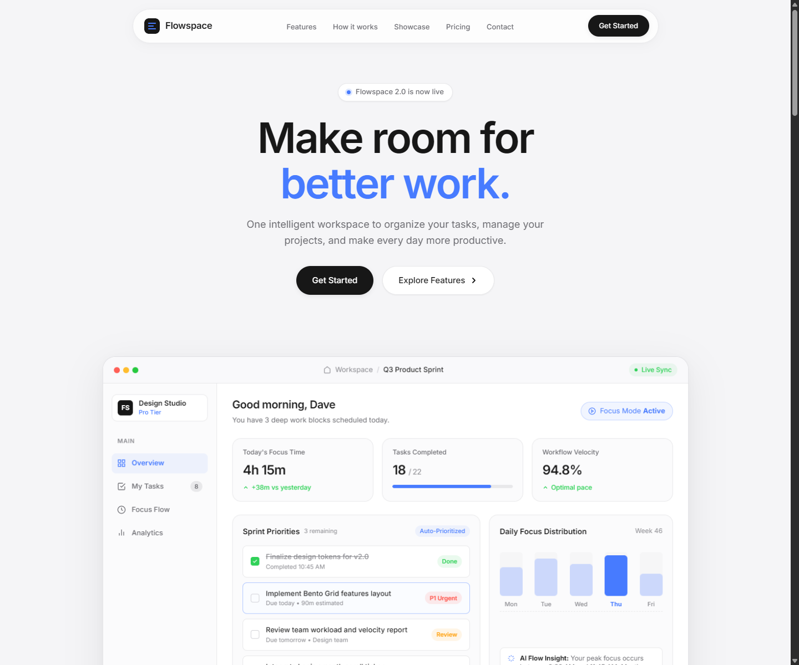
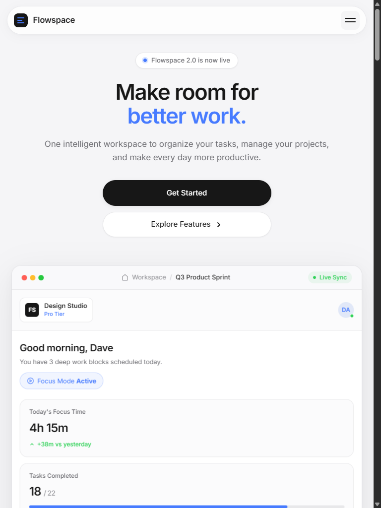

# FlowSpace — AI-Powered Productivity SaaS Landing Page

> Sankar Group | Front-End Development Internship Assignment

A fully responsive SaaS landing page built with vanilla HTML, CSS, and JavaScript. FlowSpace is a fictional AI-powered productivity platform that helps teams manage tasks, track deep work sessions, and stay in flow.

---

## 🔗 Live Demo

> https://flowspace-laksh.vercel.app/

---

## 📸 Screenshots

| Desktop (1440px) | Tablet (768px) |
|---|---|
|  |  |

---

## 🚀 Setup Instructions

### Option 1 — Run locally with Vite (recommended)

**Prerequisites:** Node.js v18+

```bash
# 1. Clone the repository
git clone https://github.com/Laksh63dave/FlowSpace.git
cd FlowSpace

# 2. Install dependencies
npm install

# 3. Start the development server
npm run dev
```

Then open [http://localhost:5173](http://localhost:5173) in your browser.

### Option 2 — Open the pre-built file directly

No server or Node.js required:

1. Download or clone the repository
2. Open `dist/index.html` directly in any modern browser

> The `dist/` build uses relative asset paths, so it works without a local server.

### Available Scripts

| Command | Description |
|---|---|
| `npm run dev` | Start Vite development server with hot reload |
| `npm run build` | Build optimized production bundle into `dist/` |
| `npm run preview` | Preview the production build locally |

---

## 🛠️ Technologies Used

| Technology | Purpose |
|---|---|
| **HTML5** | Semantic page structure with ARIA accessibility attributes |
| **CSS3** | Custom design system using CSS custom properties (variables) |
| **JavaScript (ES Modules)** | UI interactions, form validation, scroll behaviour |
| **GSAP 3** | Scroll-triggered entrance animations and motion choreography |
| **Lenis** | Smooth, physics-based scroll experience |
| **Vite** | Development server and production bundler |

---

## 📄 Page Sections

| # | Section | Description |
|---|---|---|
| 1 | **Navigation** | Sticky header with logo, nav links, and CTA button. Mobile hamburger drawer included. |
| 2 | **Hero** | Product headline, description, dual CTAs, and an interactive dashboard illustration |
| 3 | **Features** | Bento-grid layout showcasing 6 key product capabilities with icons |
| 4 | **How It Works** | 3-step numbered walkthrough of the product flow |
| 5 | **Showcase** | Dark full-bleed product screenshot section with floating badge overlays |
| 6 | **Pricing** | Three plan tiers (Starter, Pro, Enterprise) with feature lists |
| 7 | **Contact** | Demo request form with real-time validation and animated success state |
| 8 | **Footer** | Links, social icons, and copyright |

---

## ⚡ Functional Interactions

- **Smooth scroll navigation** — all nav links and CTA buttons scroll precisely to their target sections via Lenis
- **Active nav highlighting** — scroll-spy using IntersectionObserver highlights the current section in the navbar
- **Sticky header** — header gains a backdrop-blur glass effect after scrolling past 20px
- **Mobile nav drawer** — full-screen slide-in menu with Escape key and outside-click dismissal
- **Interactive dashboard** — task checkboxes in the hero toggle state and update KPI counters live
- **Pricing → form pre-fill** — clicking a pricing plan CTA scrolls to contact and pre-fills the message field
- **Form validation** — real-time inline validation on blur/input for name, email, and message fields; RFC-compliant email regex
- **Form success state** — submission replaces the form with a personalised confirmation card; resets cleanly

---

## 🎨 Design Choices & Challenges

The design draws from Apple's design language — a light, airy layout with deep dark sections for contrast, using a cool blue (`#477BFF`) as the single accent colour against an off-white background (`#F5F5F7`). Typography is set in Inter with a fluid `clamp()`-based scale so headings respond smoothly across all screen widths. Every spacing value is derived from a strict 4px/8px baseline grid defined as CSS custom properties, keeping the layout consistent without a utility framework. The hero features a fully coded dashboard mockup built entirely in HTML/CSS — no images — making it instantly personalised and fast-loading. The biggest challenge was synchronising GSAP's `ScrollTrigger` with Lenis: the solution was driving Lenis through GSAP's own RAF ticker and feeding scroll events back into `ScrollTrigger.update()`, which keeps both libraries perfectly in sync. Responsive layout uses CSS Grid with named areas that reflow at four breakpoints (1024px, 768px, 480px, 360px) rather than relying on a framework, keeping the CSS lean and fully predictable.

---

## 📁 Project Structure

```
FlowSpace/
├── index.html          # Main HTML entry point
├── css/
│   ├── style.css       # Master stylesheet & design token system
│   ├── responsive.css  # Breakpoint-specific overrides
│   └── animations.css  # CSS keyframe animations
├── js/
│   ├── main.js         # Application entry — imports all modules
│   ├── animations.js   # GSAP + Lenis scroll motion system
│   └── interactions.js # UI interactions & form validation
├── screenshots/        # Desktop and mobile layout screenshots
├── dist/               # Production build output (Vite)
├── package.json
└── README.md
```

---

## ✅ Assignment Checklist

- [x] Responsive on mobile and desktop
- [x] Navigation links scroll to sections
- [x] Buttons perform meaningful actions
- [x] Form with validation and success message
- [x] At least 3 feature cards
- [x] Pricing section with 2+ plans
- [x] Contact / footer section
- [x] Source code on GitHub
- [x] Screenshots (desktop + mobile)
- [x] Setup instructions and technologies listed

---

*Designed and built by Laksh Dave — Sankar Group Front-End Internship Assignment, 2026.*
